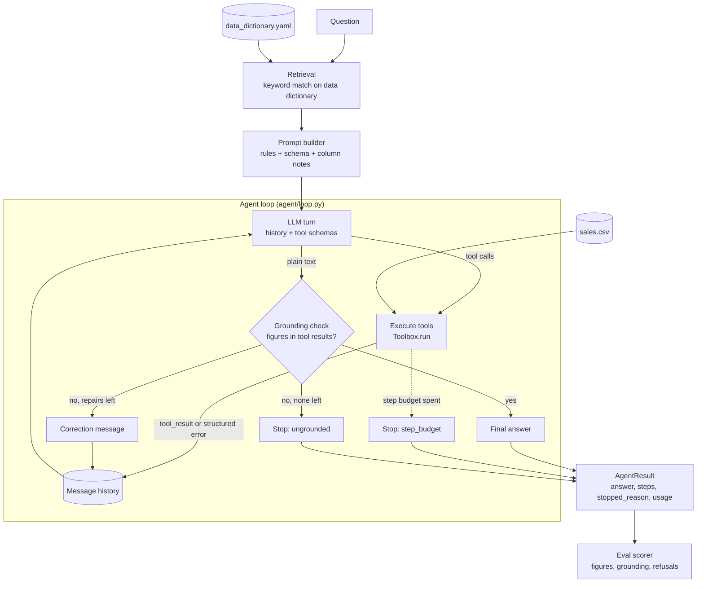

# data-analyst-agent

An LLM agent that answers plain-English questions about a CSV file. It plans,
calls analysis tools (summary statistics, group-by aggregates, correlation,
hypothesis tests, charts), reads the results, and answers. It is built around
one rule: **every figure in an answer must come from a tool result the agent
actually received.** It never estimates or recalls numbers, and it declines
questions the data cannot answer.

```text
$ python run.py --question "Which region has the highest mean revenue?" --verbose
question: Which region has the highest mean revenue?
rows: 600  max steps: 12
[1] describe_data({}) -> ok
    {"rows": 600, "columns": [{"name": "order_id", "dtype": "object", ...
[2] aggregate({"group_by": ["region"], "value": "revenue", "agg": "mean"}) -> ok
    {"group_by": ["region"], "value": "revenue", "agg": "mean", "missing_values_skipped": 24, ...
stopped: answered after 2 step(s), 3 turn(s), 0 correction(s); retrieved columns: ['region', 'revenue']; usage: {...}

East has the highest mean revenue: 562.67 per order (n=144).
```

The trace (stderr) is real tool output on the sample data, with lines cut
short. The final answer (stdout) is illustrative; its wording depends on the
model.

---

## Agentic patterns demonstrated

| Pattern | Where | What it does here |
|---|---|---|
| **Tool calling** | `tools/toolbox.py` | Six pandas/scipy tools, each with a JSON schema passed to the model through native tool use. Arguments are checked against the schema before anything runs. |
| **Grounding and retrieval** | `retrieval.py`, `prompts/system.py` | The data dictionary is searched for the columns that match the question (keyword overlap), and their notes go into the system prompt. The prompt requires every number to come from a tool result, and `grounding.py` checks the final answer against the tool results before it is returned. |
| **Orchestration loop with memory** | `agent/loop.py` | Plan → act → observe until the model answers. The message history is the agent's working memory: it only grows, so the model always sees every call it made and every result it got. |
| **Failure handling** | `tools/toolbox.py`, `agent/loop.py`, `llm/anthropic_llm.py` | Bad tool input becomes a structured error the model can read and correct. A crashing tool is caught, not fatal. An answer with unsupported figures is sent back once for correction. Step and repair budgets guarantee the run ends. A refused or truncated model turn never runs tools. |
| **Evaluation** | `evals/` | 19 questions with known answers, out-of-scope questions and ambiguous ones. The scorer checks figures, refusals and clarifications, and fails any answer whose numbers were not in a tool result. |

---

## Architecture



The three parts are kept separate:

- **Tools** (what it can do): `Toolbox` holds the DataFrame and exposes
  `specs()` (schemas) and `run(name, args)` (dispatch). It knows nothing about
  models.
- **Prompts** (how it is told to behave): `build_system_prompt` returns two
  blocks. The first (rules + schema) is the same for every question, so it can be
  cached. The second holds the column notes for this question.
- **Loop** (how turns are threaded): `Agent` depends on the `LLM` interface,
  not on a provider. `AnthropicLLM` implements it for the Messages API.
  `MockLLM` replays a script so everything can be tested offline.

### One turn of the loop

1. Send the system prompt, the full history and the tool schemas to the model.
2. Append the assistant turn to the history **unchanged**. This keeps the model's
   thinking blocks valid across turns.
3. If the model answered in text, check every figure in it against the results
   of the successful steps (figures from the question are allowed). If all
   match, stop with `answered`. If some don't and a correction is left
   (`max_repairs`, default 1), send a message naming them and go back to step 1.
   Otherwise stop with `ungrounded`, keeping the answer text.
4. Otherwise run each requested tool. Record a `Step` (tool, arguments, ok,
   result or error) and send all results back in one `tool_result` message.
5. Once `max_steps` tool calls have run, the model gets one more turn to answer
   from what it has. If it asks for tools again, stop with `step_budget`.

### File layout

```text
data-analyst-agent/
├── run.py                        CLI entry point (wraps data_analyst_agent.cli)
├── src/data_analyst_agent/
│   ├── tools/toolbox.py          Toolbox, ToolError, tool schemas
│   ├── retrieval.py              data dictionary loading + keyword retrieval
│   ├── grounding.py              number extraction + grounding check (used at runtime and by evals)
│   ├── prompts/system.py         system prompt: rules, schema, column notes
│   ├── llm/
│   │   ├── base.py               LLM interface, LLMResponse, ToolCall, ToolResult
│   │   ├── anthropic_llm.py      Messages API adapter
│   │   └── mock.py               scripted MockLLM for offline tests
│   ├── agent/loop.py             Agent, AgentResult, Step
│   └── cli.py                    argument parsing, --verbose trace, exit codes
├── evals/
│   ├── eval_questions.yaml       the eval set
│   ├── scoring.py                pure scoring functions
│   └── run_eval.py               runs the agent over the set, prints a scorecard
├── data/
│   ├── sales.csv                 600-row sample dataset
│   └── data_dictionary.yaml      column descriptions
├── scripts/generate_sample_data.py   rebuilds sales.csv deterministically
└── tests/                        pytest suite (offline)
```

### The tools

| Tool | Returns |
|---|---|
| `describe_data` | row count; each column's dtype, missing count and number of distinct values |
| `column_stats` | numeric: count, missing, mean, std, quartiles, sum. Other columns: value counts |
| `aggregate` | group by one or more columns; mean/sum/median/min/max/count/std of a numeric column, with `n` per group |
| `correlation` | Pearson r, p-value and n, using rows where both columns have values |
| `hypothesis_test` | Welch t-test or Mann-Whitney U between two groups, with each group's n, mean, median and std |
| `plot` | bar, histogram or scatter saved as PNG, plus the plotted figures so the model can cite them |

Every result is plain JSON (no numpy types, NaN becomes `null`) and reports the
sample sizes behind it.

---

## Running it

### Install

Python 3.10 or newer.

```bash
python -m venv .venv
source .venv/bin/activate          # Windows: .venv\Scripts\activate
pip install -r requirements.txt
pip install -e .                   # optional: adds the `data-analyst-agent` command
```

### API key

The agent calls the Anthropic Messages API (default model `claude-opus-5-5`).
Set a key in the environment:

```bash
export ANTHROPIC_API_KEY=sk-ant-...      # Windows PowerShell: $env:ANTHROPIC_API_KEY="sk-ant-..."
```

### Ask a question

```bash
python run.py --question "Is mean revenue different between North and South?" --verbose
```

| Option | Default | |
|---|---|---|
| `--question`, `-q` | required | the question |
| `--csv` | `data/sales.csv` | dataset |
| `--dictionary` | `data/data_dictionary.yaml` | column descriptions |
| `--max-steps` | 12 | tool-call budget |
| `--model` | `claude-opus-5-5` | |
| `--effort` | `high` | `low` to `max`; lower is cheaper and faster |
| `--output-dir` | `outputs/` | where plots are saved |
| `--verbose`, `-v` | off | print each step to stderr |
| `--json` | off | print the full `AgentResult` (every step) as JSON |

Exit codes: `0` answered, `2` stopped by the step budget, a refusal, or an
answer with unsupported figures (printed with a warning), `1`
error (missing file, no credentials, API failure).

To use your own data, write a data dictionary in the same format as
`data/data_dictionary.yaml` and pass `--csv` and `--dictionary`.

### Run the evaluation

```bash
python evals/run_eval.py                                   # all 19 items
python evals/run_eval.py --ids row_count forecast --verbose
python evals/run_eval.py --json-out outputs/eval.json      # keep every answer and step
```

This calls the live API once per item (several turns each), so it is billed.
The scorecard lists each item as PASS or FAIL with the reason, then the pass
rate by kind, how many answers contained numbers not found in any tool result,
the mean number of steps, and the number of tool errors.

Item kinds:

- **answer**: the answer must contain each expected figure (within a tolerance)
  and expected text, and every figure in it must match a tool result after
  rounding (562.67, 562.7 and 563 all match 562.666…; 562.6 does not).
- **refuse**: the data cannot answer it (profit, dates, forecasts, outside
  facts); the agent must say so.
- **clarify**: the question is ambiguous ("Which region is best?"); the agent
  must ask what is meant.

---

## Testing

```bash
pip install -r requirements-dev.txt
pytest          # 158 tests, about 6 seconds, no network or API key needed
mypy            # strict type check of src/, evals/, scripts/ and run.py
```

| File | Covers |
|---|---|
| `test_sample_data.py` | the dataset has the shape and group means it was designed with |
| `test_toolbox.py` | every tool on good input, checked against hand-worked values and scipy; `ToolError` for unknown tools, columns, arguments, wrong types and out-of-range values |
| `test_llm.py` | `MockLLM` scripting; `AnthropicLLM` request parameters and response handling, using a fake client |
| `test_retrieval_and_prompts.py` | retrieval ranking, plural handling; prompt contains rules, schema and notes |
| `test_agent.py` | the full loop with `MockLLM`: which tools run and in what order, results matched to calls, recovery from a tool error, a crashing tool, the step budget stopping a model that never answers, refusals, the runtime grounding check (correction, still wrong, question figures, turn bound), the CLI |
| `test_scoring.py` | number extraction, tolerance matching, refusal and clarification detection, grounding, item scoring |
| `test_eval_harness.py` | every expected value in the eval set is checked against the real data; a perfect scripted agent scores 100%; a mixed run produces the right scorecard |

### The sample data

`data/sales.csv` is built from a fixed design, not random draws, so the right
answers are known exactly. There are 4 regions × 3 segments with 50 orders each.
`revenue = units × unit_price`, and 24 revenue values are missing. They were
removed in pairs placed symmetrically around each group's mean, so group means
are the same with or without them. Rebuild it with
`python scripts/generate_sample_data.py`; the output is identical every time.

---

## Limitations

- **The grounding check matches values, not meaning.** A figure passes if it
  matches *any* tool result, so "West: 562.67" passes when 562.67 is East's
  mean. Small integers can match by coincidence, and numbers written as words
  ("six hundred") are not checked.
- **No arithmetic or filtering tool.** The agent cannot compute a difference,
  ratio or percentage, and the prompt tells it to say so rather than do the
  arithmetic itself. It also cannot filter rows ("orders with units > 10")
  beyond grouping.
- **Retrieval is keyword overlap.** "sales" does not match `revenue`, and there
  are no synonyms or embeddings. Retrieval only adds context to the prompt (the
  agent still sees the full schema), so a miss costs grounding, not access.
- **The offline tests check the plumbing, not the model.** `MockLLM` proves
  the loop, error handling and scoring work. Only `run_eval.py` against the live
  API measures answer quality, and no baseline score is published here yet.
- **The scorer's refusal and clarification checks are phrase-based**, so an
  unusual wording can be scored wrongly. Read failing items with `--verbose`.
- **One table, held in memory.** No joins, no SQL, no files larger than RAM.
- **The history grows every turn** and is resent in full. That is fine for a
  12-step budget, but there is no compaction or prompt caching yet.
- **Statistical scope is narrow:** two-group tests only, with no
  multiple-comparison correction and no check of test assumptions.
- **The sample data is synthetic and tidy.** Real data with messy types, dates
  or high-cardinality columns has not been tested.

## Roadmap

1. **`compute` and `filter` tools:** safe arithmetic on figures from earlier
   results, and row filters, so derived and conditional questions can be answered
   without breaking the grounding rule.
2. **Prompt caching** on the stable system block and tool schemas, to cut cost
   per turn.
3. **Eval baseline in CI:** record a live scorecard, then fail a PR whose
   pass rate or grounding drops.
4. **Better retrieval:** synonyms in the data dictionary first, embeddings
   if that isn't enough.
5. **SQL backend (DuckDB)** for multiple tables and larger files.
